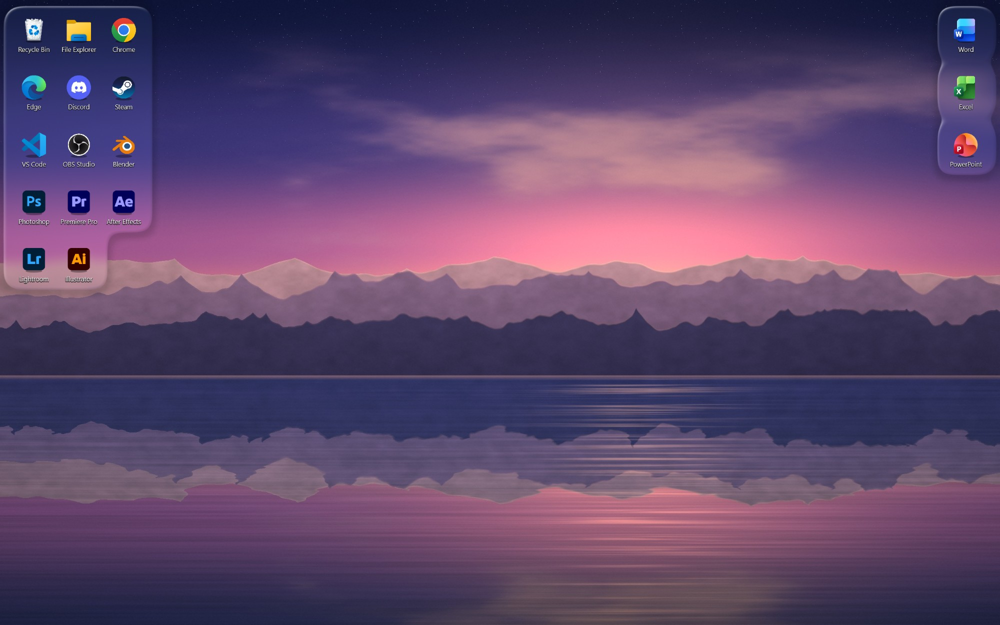
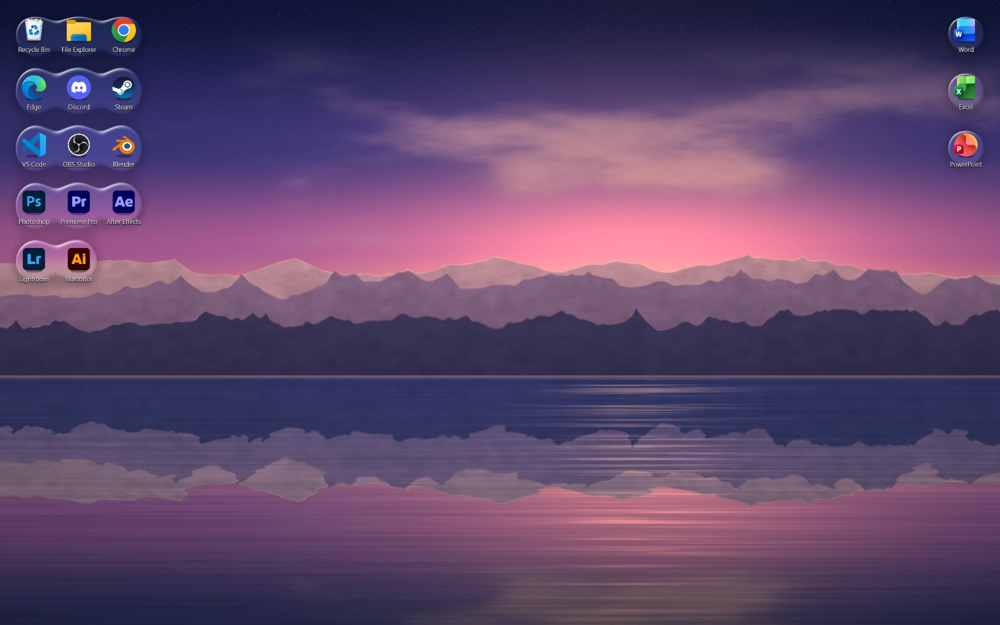

<p align="center">
  
</p>

# icodrop

배경과 아이콘을 더욱 조화롭게.

바탕화면 아이콘 뒤에 물방울이 번진 것처럼 배경을 블러 처리해서, 아이콘이 배경 위에 또렷하게 보이도록 하는 Windows 프로그램입니다. 아이콘을 옮기거나 추가하면 블러 영역이 따라가고, 이웃한 아이콘 뒤의 블러는 표면장력으로 붙은 물방울처럼 이어집니다.

## 미리보기

| 적용 전 | 수면 |
|:---:|:---:|
|  |  |

| 방울 | 유리 |
|:---:|:---:|
|  |  |

위 이미지는 실제 바탕화면을 캡처한 것이 아니라, 앱의 렌더링 코드(`BlurEngine.RenderFrame`)에 샘플 배경과 아이콘 배치를 넣어 그린 것입니다. 배경([`docs/wallpaper.jpg`](docs/wallpaper.jpg))은 [`tools/make-wallpaper.ps1`](tools/make-wallpaper.ps1)으로 직접 생성한 이미지이고, 아이콘 위의 블러 영역은 앱이 만드는 결과와 같은 코드로 그렸습니다. 아이콘과 이름은 각 소유자의 상표이며 예시를 위해서만 사용했습니다. 다시 만들려면 `tools\build-previews.ps1`을 실행하세요.

## 어떻게 동작하나

1. 탐색기의 바탕화면 목록에서 아이콘 위치를 읽습니다.
2. 현재 배경화면에 아이콘 주변만 블러를 입힌 이미지를 새로 만듭니다.
3. 그 이미지를 Windows 배경화면으로 설정합니다. 원래 배경화면과 맞춤 방식은 기억해 두었다가 종료할 때 되돌립니다.

배경화면 이미지를 통째로 바꾸는 방식이라 아이콘이 움직이는 순간의 애니메이션은 없습니다. Windows 11 24H2 이후에서는 다른 프로그램이 만든 창이 바탕화면 레이어에 표시되지 않아서, Wallpaper Engine 같은 "배경 위치에 창을 끼우는" 방식을 쓸 수 없었습니다.

## 설치

[Releases](../../releases)에서 `icodrop-setup.exe`를 받아 실행합니다. 관리자 권한은 필요 없고 `%LocalAppData%\Programs\icodrop`에 설치됩니다.

코드 서명이 없어서 처음 실행할 때 SmartScreen이 "알 수 없는 게시자" 경고를 띄울 수 있습니다. `추가 정보` → `실행`으로 진행하면 됩니다.

창 없이 설치하려면:

```
icodrop-setup.exe /silent [/dir=경로] [/nodesktop] [/nomenu] [/noautostart] [/norun]
```

## 사용

- 실행하면 설정 창이 열리고 작업 표시줄 트레이에 아이콘이 생깁니다. 창을 닫아도 프로그램은 계속 실행됩니다.
- 이미 실행 중일 때 `icodrop.exe`를 다시 실행하면 설정 창이 나옵니다.
- 프리셋은 `수면`, `방울`, `유리` 세 가지입니다.
- 첫 화면에는 블러 정도와 그림자 정도만 있고, 나머지는 `세부 설정`에 있습니다. 영역마다 오른쪽의 되돌리기 아이콘으로 기본값으로 돌릴 수 있습니다.
- 슬라이더는 0.5 단위이고, 슬라이더 위에서 `Ctrl` + 마우스 휠, 또는 화살표 키로 미세 조정합니다.
- 처음 실행하면 Windows 시작 시 자동 실행이 켜집니다. 설정 창의 `세부 설정` → `일반`에서 끌 수 있습니다.
- 종료는 트레이 메뉴의 `종료`입니다. 종료하면 원래 배경화면으로 돌아갑니다.

명령줄 옵션:

| 옵션 | 동작 |
|---|---|
| `icodrop.exe --background` | 설정 창 없이 트레이로만 시작 (자동 실행이 쓰는 방식) |
| `icodrop.exe --quit` | 실행 중인 icodrop에 종료를 요청 (배경화면 복원 포함) |

## 제거

`설정` → `앱` → `설치된 앱`에서 icodrop을 지우거나, 설치 폴더의 `uninstall.exe`를 실행합니다. 설정과 생성된 이미지도 함께 지울지 묻습니다. 무인 제거는 `uninstall.exe /uninstall /silent [/removedata]`입니다.

## 파일 위치

| 무엇 | 어디에 |
|---|---|
| 프로그램 | `%LocalAppData%\Programs\icodrop` |
| 설정과 로그 | `%AppData%\WallBlur` |
| 생성된 배경 이미지 | `%UserProfile%\Pictures\WallBlur` |

생성된 이미지를 `Pictures`에 두는 이유는, 이 환경에서 `AppData` 아래 폴더의 이미지는 Windows가 배경화면으로 읽지 못하고 검게 표시했기 때문입니다.

## 알려진 한계와 주의

- **보안 프로그램이 경고할 수 있습니다.** 바탕화면 아이콘 위치를 얻으려면 탐색기 프로세스의 메모리에 작은 값을 쓰고 읽어야 해서(`VirtualAllocEx`, `WriteProcessMemory`), 코드 주입처럼 보이는 API를 씁니다. 하는 일은 `LVM_GETITEMRECT` 메시지가 요구하는 `RECT` 버퍼 하나를 탐색기 안에 두는 것뿐이고 코드는 [Targets.cs](Targets.cs)에 있습니다.
- **Windows 11(빌드 26300), 모니터 1개, 배율 150% 환경에서만 확인했습니다.** 모니터 여러 개, 배경화면 슬라이드쇼, 라이트 테마에서의 설치 창, Windows 10, 재부팅 후 자동 실행은 확인하지 못했습니다.
- 다른 배경화면 프로그램과 함께 쓰면 서로 배경을 덮어쓸 수 있습니다.
- 프로그램이 비정상 종료되면 블러가 입혀진 배경이 남을 수 있습니다. 다음 실행 때 원래 배경을 복구하지만, 그 전에는 설정에서 직접 배경을 바꿔야 합니다.
- 값을 바꿀 때마다 약 16MB짜리 이미지 파일을 새로 씁니다.
- UI는 한국어만 있습니다.

## 빌드

Windows에 기본으로 들어 있는 C# 컴파일러(.NET Framework 4.8, Windows 10 1903 이후와 Windows 11에 포함)만 쓰므로 SDK 설치가 필요 없습니다.

```
powershell -ExecutionPolicy Bypass -File build.ps1             # icodrop.exe
powershell -ExecutionPolicy Bypass -File build-installer.ps1   # dist\icodrop-setup.exe (위 빌드 포함)
powershell -ExecutionPolicy Bypass -File make-icon.ps1         # icodrop.ico 다시 그리기
```

| 파일 | 하는 일 |
|---|---|
| [Program.cs](Program.cs) | 진입점, 트레이, 단일 실행, 자동 실행 |
| [BlurEngine.cs](BlurEngine.cs) | 아이콘 감시, 배경 합성(블러, 그림자, 테두리 광택, 굴절), 배경화면 설정과 복원 |
| [MaskBuilder.cs](MaskBuilder.cs) | 둥근 사각형 거리장을 합쳐 영역 모양 만들기 |
| [Wallpaper.cs](Wallpaper.cs) | 현재 배경화면 읽기와 블러 |
| [Targets.cs](Targets.cs) | 탐색기에서 아이콘 위치 읽기 |
| [SettingsWindow.cs](SettingsWindow.cs), [Settings.cs](Settings.cs) | 설정 창과 저장 |
| [installer/Installer.cs](installer/Installer.cs) | 설치/제거 프로그램 |

## 라이선스

[MIT](LICENSE)
